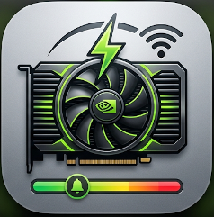

<a id="readme-top"></a>

<div align="center">
  
  <h1>NVBeacon</h1>
  <p>A native macOS menu bar app for remote NVIDIA GPU monitoring over SSH.</p>
  <p>
    
    
    
    
  </p>
  <p>
    <a href="https://github.com/jaein4722/NVBeacon/releases">Download Latest Release</a>
    ·
    <a href="https://jaein4722.github.io/NVBeacon/">Website</a>
    ·
    <a href="https://github.com/jaein4722/NVBeacon/issues">Report Bug</a>
    ·
    <a href="https://github.com/jaein4722/NVBeacon/issues">Request Feature</a>
  </p>
</div>

## About

NVBeacon gives you a fast view of one or more remote NVIDIA GPU servers from the macOS menu bar without keeping Terminal open.

It connects over `ssh`, runs `nvidia-smi` on each enabled target server, and turns the result into a compact menu bar summary plus a detailed popover UI with GPU utilization, memory, process details, and job alerts. It is built for people who regularly ask:

- Is the server busy right now?
- Which GPU is running my job?
- Which process is running on that GPU?
- Did my training job finish?
- Has a watched GPU stayed idle long enough to reuse?

## Screenshots

<div align="center">
  
</div>

<p align="center"><em>At-a-glance menu bar summary</em></p>

<div align="center">
  
  
</div>

<p align="center"><em>Detailed light and dark mode popovers with per-GPU status, process details, and job notification controls</em></p>

## Features

- Native macOS menu bar UI with compact status text or icon-only mode
- Remote NVIDIA GPU monitoring over `ssh` using `nvidia-smi`
- Multiple server targets with per-server enable/disable, authentication, connection reuse, and remote command settings
- Per-GPU utilization, memory, temperature, and process count
- Per-server Linux RAM usage, available memory, and Swap usage with high-usage color indicators
- On-demand process details with user, PID, memory, and command preview
- Automatic detection and highlighting of your own remote SSH user processes and GPUs
- Job completion alerts through macOS Notification Center when watched GPU processes exit
- GPU idle notifications with configurable idle duration and memory threshold
- Configurable busy GPU detection based on active processes, memory usage, or utilization
- Built-in update checks using Sparkle, the standard macOS update framework
- Optional launch at login using the standard macOS login item mechanism
- Import from local `~/.ssh/config`
- SSH key authentication and password-based authentication
- English / Korean UI with a `System` language option
- Light / dark / system appearance support
- Optional Dock icon and configurable popover outside-click behavior

## Installation

### Homebrew

```bash
brew install --cask jaein4722/tap/nvbeacon
```

### GitHub Releases

Download the latest `.dmg` from the [Releases page](https://github.com/jaein4722/NVBeacon/releases).

### Manual Installation

1. Download the latest `NVBeacon-<version>.dmg` from [GitHub Releases](https://github.com/jaein4722/NVBeacon/releases).
2. Open the DMG.
3. Drag `NVBeacon.app` into `Applications`.
4. Launch the app from `Applications`.
5. If macOS blocks the app because it cannot verify the developer, open `System Settings > Privacy & Security` and choose `Open Anyway`.

## Requirements

- macOS 14 or later
- SSH access from your Mac to the target server
- `nvidia-smi` available on the remote host

## Quick Start

1. Launch NVBeacon.
2. Right-click the menu bar item and open `Settings…`.
3. Add a server target directly or import a saved host from `~/.ssh/config`.
4. Add more server targets if you want one menu bar summary across multiple machines.
5. Choose the authentication method for each server.
6. Allow notifications if you want job completion or GPU idle alerts.
7. Left-click the menu bar item to open the GPU popover.
8. Open the `About` tab when you want to check for a newer release manually.

All settings apply automatically. There is no separate apply button.

## Memory Monitoring

Each server's popover shows RAM used / total, available RAM, and Swap used / total. Server RAM and Swap bars turn orange at 85% usage and red at 95%; these are usage indicators, not OOM detection or notifications. GPU cards retain the compact side-by-side `Util` and `Memory` bars, with orange utilization and blue memory usage.

RAM is read from Linux `/proc/meminfo` in the same SSH poll as GPU metrics. Used RAM is `MemTotal - MemAvailable`, so reclaimable cache is accounted for. Unsupported or unreadable memory data appears as unavailable without interrupting GPU monitoring.

In `Advanced` settings, `GPU Query Command` and `Memory Query Command` apply to the server selected in `General`. The memory command defaults to `cat /proc/meminfo`; a custom command must return the same field names and `kB` units (`MemTotal`, `MemAvailable`, and optionally `SwapTotal` / `SwapFree`). An empty command restores the default. The memory query runs once per server within the existing SSH refresh, not once per GPU or in an extra SSH connection. A failed memory command leaves GPU monitoring available.

The existing polling interval defaults to 10 seconds and can be set to 1 second in Settings. Actual updates also depend on SSH command duration; brief allocation peaks can be missed. Host RAM totals do not show container, cgroup, or scheduler job memory limits, and free VRAM alone does not guarantee a CUDA allocation will succeed.

## Notifications

NVBeacon supports two kinds of work alerts for remote GPU jobs:

- `Process Exit`: watch a running GPU process and get notified when it really exits
- `GPU Idle`: star a GPU and get notified when it stays idle long enough for the next job

You can manage notification permission, active watches, and recent notification history from the `Notifications` tab in Settings.

## Settings Overview

NVBeacon uses a native macOS-style settings window with these sections:

- `General`: server list, per-server connection/authentication, polling, startup, busy GPU detection, update preferences
- `Notifications`: permission, test notification, active watches, history, idle thresholds
- `Appearance`: theme, language, Dock icon, menu bar summary, popover width and behavior
- `Advanced`: remote command override
- `About`: version, links, runtime summary, and current configuration

`Appearance` → `Popover Width` adjusts the menu bar popover from 480 to 800 pt, with a default of 500 pt. The width is saved and applies automatically to both the popover and its content. Height continues to adapt to the content and available screen space.

## Language Support

The interface can be set to:

- `System`
- `English`
- `Korean`

`System` follows the current macOS language. Unsupported system languages fall back to English.

## Notes

- NVBeacon uses your local SSH setup directly, including `~/.ssh/config`.
- In key-based mode, background polling does not read from Keychain.
- In password-based mode, each server password is stored in macOS Keychain and unlocked into memory once per app session to avoid repeated Keychain prompts during polling.
- The first time you switch to password-based mode, NVBeacon shows a security warning because this mode is less secure than SSH keys.
- If the remote non-interactive shell has a limited `PATH`, set `Remote Command` to an absolute path such as `/usr/bin/nvidia-smi`.
- Public DMG downloads may still trigger a Gatekeeper warning unless the release is signed and notarized.
- Launch at login is only available from a packaged app bundle, not `swift run`.
- Short release notes are tracked in [CHANGELOG.md](CHANGELOG.md).

## For Developers

Development, packaging, test app, and release workflow notes live in [docs/DEVELOPMENT.md](docs/DEVELOPMENT.md).

## License

Distributed under the MIT License. See [LICENSE](LICENSE) for details.

## Acknowledgments

- [Best README Template](https://github.com/othneildrew/Best-README-Template) for the structural inspiration

<p align="right">(<a href="#readme-top">back to top</a>)</p>
